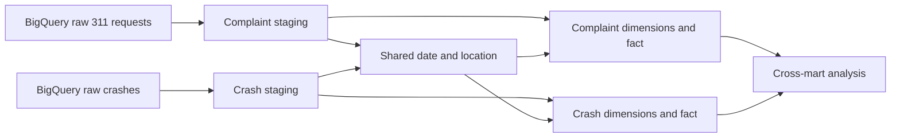
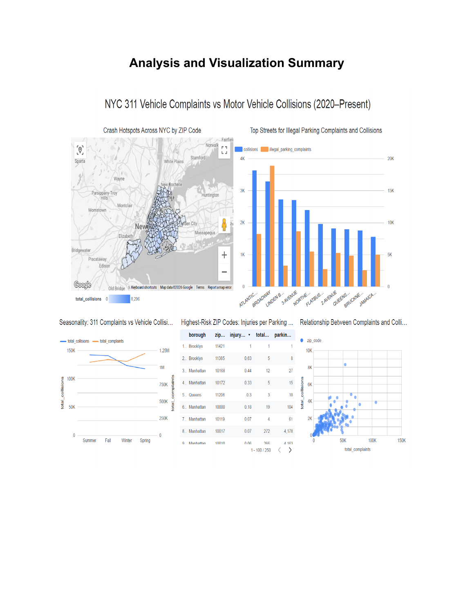

# NYC Open Data Warehouse

**A portfolio project by Victor Chen connecting NYC 311 vehicle complaints with motor vehicle collisions.**

SQL · dbt · BigQuery · Python · Looker Studio

## Project overview

The project brings service requests and crash records into two analytical data marts with shared date and location dimensions. The goal is to explore geographic patterns and identify locations for closer traffic-safety investigation. Complaint volume is a screening input, not proof of causation or a validated predictor of collisions.

## Main warehouse

The complete dbt project is in [`warehouse/`](warehouse/). It includes:

- Two staging models for vehicle complaints and crashes.
- Two fact tables and seven dimensions, including shared date and location.
- Source definitions with primary-key tests, package dependencies, and schema configuration.
- Sample-query models and the restaurant/transit coursework under `models/assignment_work`.

All 31 files from the supplied branch archive are preserved byte-for-byte in `warehouse/`. The project-specific models live in [`warehouse/models/group_16_project/`](warehouse/models/group_16_project/). The branch name does not limit the included work to staging: it also contains the dimensional marts and facts.



See [main-project setup](docs/setup.md) for BigQuery requirements and the distinction between the main warehouse and the optional demo.

## Dashboard

The project report's dashboard explores crash hotspots, street-level complaint/crash comparisons, seasonal patterns, and injury ratios. This is a saved screenshot, not a live dashboard or output from the synthetic demo. Its small-denominator ratios and location labels require validation before reuse as a ranking.



The report describes a visually positive association between complaint and crash volumes by ZIP. These observations have not been independently verified by running the main warehouse here; they do not establish causality or measured safety improvements.

## Runnable local example

[`examples/local-demo/`](examples/local-demo/) contains a self-contained demonstration with synthetic data, its own dbt project, Python ingestion utilities, analytical reporting tables, tests, and deployment documentation.

```bash
python3 -m venv .venv
source .venv/bin/activate
pip install -r examples/local-demo/requirements.txt
python examples/local-demo/scripts/demo.py
```

No Google Cloud account is needed for the demo. Its simplified model, raw-field selection, profiles, and pipeline belong together: **it is not a drop-in loader or test suite for the main warehouse.** In particular, the main warehouse uses a `dim_people` table and compound vehicle dimensions; the example keeps casualty counts on the crash fact and uses a vehicle bridge.

The example previously passed 43 data tests, one metric unit test, and 15 Python tests. See [validation](docs/validation.md) for the scope of these checks. Synthetic values are not NYC findings.

## Repository layout

```text
warehouse/                  Complete class branch, including all coursework
examples/local-demo/        Independent runnable demo and supporting pipeline
config/                     Example BigQuery connection settings
scripts/                    File-preservation and dependency-reference checks
docs/                       Main setup, validation, and GitHub publishing
.github/workflows/          Source-integrity and demo CI
```

- [BigQuery setup](docs/setup.md)
- [Validation and known limitations](docs/validation.md)
- [Publish to GitHub](docs/publishing.md)
- [Demo data model and metrics](examples/local-demo/docs/data-model.md)
- [Dashboard setup guide](examples/local-demo/docs/dashboard.md)

Source data: [NYC 311 requests](https://data.cityofnewyork.us/resource/erm2-nwe9.json) and [Motor Vehicle Collisions](https://data.cityofnewyork.us/resource/h9gi-nx95.json). Source data is subject to its publisher's terms. No credentials or raw data dumps are included.
