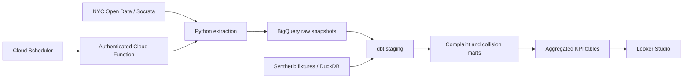

# NYC Street Safety Data Warehouse

**Connecting 311 vehicle complaints with motor vehicle collisions through a tested analytical warehouse.**

Python · SQL · dbt · BigQuery · Cloud Functions · Cloud Scheduler · Looker Studio · DuckDB demo

A portfolio project by **Victor Chen** exploring NYC 311 complaints and motor vehicle collisions through dimensional modeling, cloud ingestion, and business intelligence. Includes a runnable synthetic-data demo and a BigQuery deployment path.

## Why this project

Resident complaints and police-reported crashes describe different sides of street safety. Bringing them into a common analytical model makes it possible to investigate where they overlap, compare patterns over time, and identify locations that merit further study.

The project asks: **How can vehicle-related 311 complaints support the investigation of collision patterns across New York City?** It is an exploratory data engineering and business intelligence project, not a crash prediction system or evidence that an intervention reduced collisions.

## Run it in a few minutes

Python 3.12 or 3.13 is recommended. From the repository root:

```bash
python3 -m venv .venv
source .venv/bin/activate
pip install -r requirements.txt
python scripts/demo.py
```

On Windows, activate with `.venv\Scripts\Activate.ps1` in PowerShell.

The demo loads synthetic fixtures into DuckDB, builds the **same dbt models** used by the BigQuery target, runs data-quality and Python tests, and exports CSVs plus `output/demo-summary.json`. No cloud account, API token, or live data is required. Dependency installation requires internet access.

Expected synthetic output: **7 complaints and 5 crashes** after deduplication; **6 complaints and 4 crashes** in ZIP-level reporting because each source contains one record with a missing ZIP. These counts are test expectations, not NYC findings. Re-running the demo replaces only the local demo raw tables.

To browse model documentation after the demo:

```bash
dbt docs generate --profiles-dir config --target demo
dbt docs serve --profiles-dir config --port 8080
```

## Architecture



- **Extract and load:** bounded date windows, keyset pagination, retryable API requests, explicit raw schemas, and upserts by source ID.
- **Transform:** deduplication, type handling, normalized location fields, stable dimension keys, and tests for fact grain and relationships.
- **Model:** two fact tables linked to shared date/location dimensions; a vehicle bridge preserves multiple reported vehicles per crash.
- **Analyze:** ZIP and street comparisons aggregate each fact independently before joining, preventing many-to-many inflation.
- **Validate:** local integration tests and GitHub Actions cover the complete synthetic workflow.

## Analytical outputs

| Output | Grain | Use |
| --- | --- | --- |
| `kpi_daily_zip` | Date × ZIP | Comparable daily complaint and crash counts |
| `kpi_daily_street` | Date × borough × ZIP × street | Street comparisons and hotspots |
| `kpi_zip_summary` | ZIP over the selected window | Scatter plot, map, and injury ratios |
| `kpi_monthly_trends` | Calendar year × month | Chronological trends |
| `kpi_data_quality` | Source | Missing ID, date, ZIP, and street counts |

The default analysis window is **January 1–31, 2025**, with February 1 as the exclusive endpoint. Use the same window for both datasets. This default provides a reproducible example window.

```bash
dbt build --profiles-dir config --target demo --vars '{"analysis_start": "2025-01-01", "analysis_end": "2025-02-01", "minimum_parking_complaints": 20}'
```

## Analysis and dashboard

The project report described a visually positive association between complaint and crash volumes by ZIP and identified streets where the two coexist. These observations motivate further investigation. The report did not provide a statistical correlation estimate, exposure-adjusted risk model, or causal test.

The dashboard screenshot below is from the project report; it is not generated by the synthetic demo. Labels and values are preserved; the injury table has small denominators and location inconsistencies that require validation before reuse. “Present” in the screenshot refers to the saved dashboard snapshot, not a live refresh.


The reporting models use chronological year/month comparisons and suppress injury-to-parking-complaint ratios below a configurable minimum denominator. The default minimum of 20 is a screening heuristic, not a statistically validated threshold.

## Documentation

- [Cloud setup and ingestion](docs/cloud-setup.md)
- [Data model, grain, and metric definitions](docs/data-model.md)
- [Looker Studio dashboard build guide](docs/dashboard.md)
- [Scope and limitations](docs/limitations.md)
- [Validation record](docs/validation.md)
- [Publishing this repository to GitHub](docs/publishing.md)

## Repository map

```text
ingestion/        Socrata extraction, BigQuery merge, HTTP function
models/staging/   Type handling, scope filtering, latest-record selection
models/marts/     Fact tables, shared dimensions, and vehicle bridge
models/reporting/ Comparable aggregate tables and quality measures
macros/           DuckDB/BigQuery-compatible SQL helpers
analyses/         Additional dbt-compiled analytical SQL
scripts/          Offline demo, exports, cloud initialization
config/           Credential-free dbt profiles
tests/            Python behavior tests and dbt SQL assertions
data/demo/        Explicitly synthetic fixtures
docs/             Architecture, dashboard, limitations, and deployment notes
.github/          Automated offline validation
```

## Data sources and references

- [NYC 311 Service Requests, 2020 to Present](https://data.cityofnewyork.us/Social-Services/311-Service-Requests-from-2020-to-Present/erm2-nwe9): filtered to NYPD and Illegal Parking, Blocked Driveway, Abandoned Vehicle, Noise - Vehicle, and Traffic.
- [Motor Vehicle Collisions – Crashes](https://data.cityofnewyork.us/Public-Safety/Motor-Vehicle-Collisions-Crashes/h9gi-nx95): police-reported crash events.
- [Socrata API documentation](https://dev.socrata.com/docs/queries/): this implementation uses the existing `/resource` SoQL endpoint; SODA3 is a possible future migration.
- [dbt BigQuery configuration](https://docs.getdbt.com/reference/resource-configs/bigquery-configs).

No source-data dump, access token, or cloud key is included. Public source data remains subject to its publisher's terms. See [scope and limitations](docs/limitations.md) for analytical and operational considerations.
