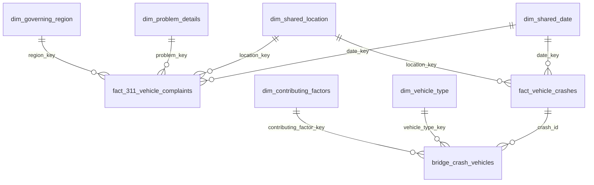

# Model and metrics

## Fact grains

`fact_311_vehicle_complaints`: one in-scope request (`complaint_id`). `fact_vehicle_crashes`: one police-reported collision (`crash_id`). The latest ingested snapshot of an ID wins; equal ingestion timestamps are assumed to contain identical source records. A unique, non-null ID and valid event date are required by downstream tests.

Casualty counts remain nullable integer measures on the crash fact. Negative values fail a data test. Reporting sums observed counts with nulls treated as zero, but exposes `crashes_with_missing_measures`; the injury-to-complaint screening ratio is suppressed if relevant injury measures are missing. These are descriptive counts of reported outcomes, not estimates of unreported injuries.

## Shared dimensions

- `dim_shared_date`: one observed calendar date; no artificial zero-filled dates. Hour is a fact attribute. Dates/times retain the source's NYC local civil-time interpretation; they are not silently converted to UTC.
- `dim_shared_location`: normalized borough, five-digit ZIP, and street. Whitespace and letter case are standardized; street aliases and geocoding are not resolved. This dimension does not certify a ZIP-to-borough relationship.
- Complaint dimensions: complaint type/descriptor (`dim_problem_details`) and borough/community board (`dim_governing_region`).
- Crash dimensions: reported vehicle category and contributing factor. `bridge_crash_vehicles` links up to five source vehicle slots to each crash. Never sum crash measures after joining this bridge without first restoring crash grain.

Keys hash length-prefixed values with a distinct null representation. That avoids ambiguity between nulls, empty strings, and concatenated values. Hashes provide stable identifiers, not anonymization.

## Joining the sources

There is no claim that an individual complaint corresponds to an individual crash. Each source is independently aggregated to a common date/ZIP or date/borough/ZIP/street grain, then full-outer joined. Complaint-only and crash-only groups remain present. ZIP-level comparisons group by ZIP alone so an inconsistent borough label does not create duplicate ZIPs.

Unknown ZIPs remain in facts and data-quality counts but are excluded from geographic reporting. Street comparisons also exclude unknown street names. Missing dates cause integrity tests to fail instead of being silently approved.

## Metric contract

All reporting uses `[analysis_start, analysis_end)`. The operator must load both sources completely for that window; the code does not infer completeness from minimum and maximum dates. An absent observation is not proof that extraction completed successfully. Keep ingestion manifests and verify both sources before reporting.

| Field | Definition |
| --- | --- |
| complaints | Count of in-scope service requests |
| parking_complaints | Count where complaint type is exactly Illegal Parking |
| crashes | Count of reported crash IDs |
| complaints_per_crash | Total complaints / total crashes; null for zero crashes |
| injuries_per_crash | Reported persons injured / crashes; descriptive severity measure |
| vulnerable_injuries | Pedestrians injured + cyclists injured |
| vulnerable_injuries_per_parking_complaint | Vulnerable injuries / illegal-parking complaints; null below minimum denominator or with missing measures |

Compute ratios from summed numerators and denominators, never by averaging ZIP or daily ratios. The injury/complaint metric is not an injury probability or exposure-adjusted risk rate. Monthly output includes known-ZIP records only, to match the geography-based dashboard population.

## Design decisions

Crash data supplies aggregate casualty counts rather than person-level records, so the warehouse stores these as fact measures. Five vehicle/factor slots are represented by a bridge instead of flattening every crash into a single vehicle type. There is no manufactured person-level dataset.

Tables use full rebuilds for simplicity. This favors transparency in a portfolio-scale example; it is not a cost-optimized design for unrestricted full-history runs. Production extensions include source revision watermarks, incremental transformations, partitioning, geocoding validation, source-coverage audits, and exposure-adjusted analysis.
